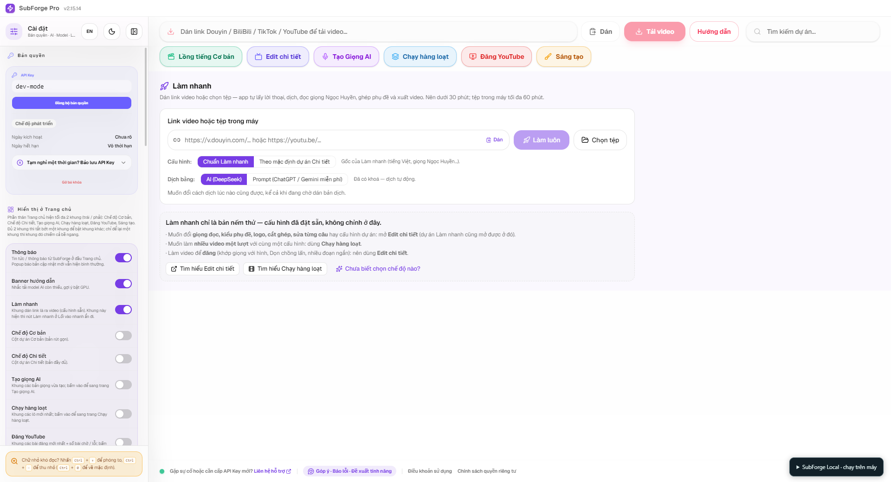

<div align="center">

# SubForge

Dịch video · Tạo phụ đề · Lồng tiếng bằng AI

[**Tải xuống**](https://github.com/K07VN/SubForge-Open-Soucre/releases) · [Cài đặt](#cài-đặt) · [Chạy ứng dụng](#chạy-ứng-dụng)

[decompile.tnkre.dev](https://decompile.tnkre.dev) · [tnkre.dev](https://tnkre.dev)

</div>



## Yêu cầu

Windows 64-bit, [Node.js LTS](https://nodejs.org/) và [7-Zip](https://www.7-zip.org/). Cần Internet để tải tài nguyên và cài Electron lần đầu.

## Tải xuống

| Gói | Nội dung | Khi nào cần |
| --- | --- | --- |
| [Bộ đầy đủ · 12,96 GB](https://github.com/K07VN/SubForge-Open-Soucre/releases/tag/local-data-2026-10-28) | Runtime và toàn bộ model AI | Cài đặt lần đầu |
| [Runtime · 2,71 GB](https://github.com/K07VN/SubForge-Open-Soucre/releases/tag/runtime-2026-10-28) | Python, CUDA, llama.cpp, Qwen, FFmpeg, OCR và thư viện | Đã có model, cần bổ sung runtime |

Tải đủ các phần `.001`, `.002`, … của **một gói**, đặt cùng thư mục rồi dùng 7-Zip giải nén phần `.001` vào gốc dự án. Kiểm tra hash bằng `SHA256SUMS.txt` đi kèm. Bộ đầy đủ cần khoảng 20 GB trống để giải nén, ngoài dung lượng các phần đã tải.

## Cài đặt

```powershell
git clone https://github.com/K07VN/SubForge-Open-Soucre.git
cd SubForge-Open-Soucre
npm.cmd ci --no-audit --no-fund
```

Giải nén gói tài nguyên vào đây. Sau đó chuẩn bị giao diện:

<details>
<summary><strong>Lệnh dựng giao diện</strong></summary>

```powershell
New-Item -ItemType Directory -Path .\frontend\dist\assets -Force | Out-Null
Copy-Item .\frontend\public\* .\frontend\dist -Recurse -Force
Copy-Item .\frontend\src\app.js .\frontend\dist\assets\app.js -Force
Copy-Item .\frontend\src\styles.css .\frontend\dist\assets\app.css -Force
Copy-Item .\frontend\src\local-mode.js .\frontend\dist\local-mode.js -Force
$html = Get-Content .\frontend\index.html -Raw -Encoding UTF8
$html = $html.Replace('./src/app.js', './assets/app.js').Replace('./src/styles.css', './assets/app.css').Replace('./src/local-mode.js', './local-mode.js')
[IO.File]::WriteAllText((Join-Path (Get-Location) 'frontend\dist\index.html'), $html, [Text.UTF8Encoding]::new($false))
```

Chạy lại khi thay đổi mã giao diện.

</details>

## Chạy ứng dụng

Mở ba cửa sổ PowerShell tại gốc dự án, chạy lần lượt:

**1. Máy chủ AI**

```powershell
& .\local-data\runtime\llama-cpp\llama-server.exe -m .\local-data\data\ai_models\llm\qwen2.5-3b-instruct-q4_k_m.gguf --host 127.0.0.1 --port 18081 --alias subforge -c 32768 -ngl 0 --jinja
```

**2. Backend** — đợi máy chủ AI sẵn sàng trước khi chạy.

```powershell
$env:SUBFORGE_OFFLINE_ONLY = '1'
$env:SUBFORGE_LOCAL_LLM_BASE_URL = 'http://127.0.0.1:18081/v1'
$env:SUBFORGE_LOCAL_LLM_MODEL = 'subforge'
& .\local-data\runtime\python312\python.exe -I -B .\backend\local_main.py
```

**3. Giao diện** — đợi backend sẵn sàng tại `http://127.0.0.1:18080`.

```powershell
npx.cmd --no-install electron .
```

Đóng giao diện và nhấn **Ctrl+C** tại hai cửa sổ dịch vụ để dừng. Sau khi cài đủ tài nguyên, có thể sử dụng không cần Internet.

## AI & GPU

Qwen2.5 · Whisper Base/Medium/Large-V3 · VieNeu/MOSS · Qwen3-TTS · Demucs · RapidOCR.

Runtime kèm PyTorch/torchaudio **2.7.1+cu126**, hỗ trợ GTX 1070/Pascal với kernel `sm_61`. Máy đích cần driver NVIDIA tương thích. LLM mặc định chạy CPU; Qwen3-TTS dùng backend Vulkan đi kèm.

Nếu cần dùng CPU, đặt `$env:SUBFORGE_DISABLE_CUDA_RUNTIME='1'` trước khi khởi động backend.

## Cấu trúc

```text
backend/          API, xử lý video và dịch vụ AI
desktop/          Electron và IPC
frontend/src/     JavaScript, CSS
frontend/public/  Font, icon, tài nguyên
runtime/          Thư viện và công cụ từ Releases
local-data/       Python, CUDA, model và dữ liệu ứng dụng
```

Runtime, model, `node_modules` và `frontend/dist` được Git bỏ qua. Không đưa dữ liệu dự án, cookie hay token vào repository.
